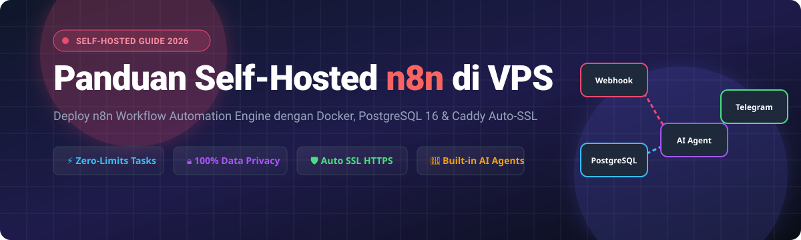
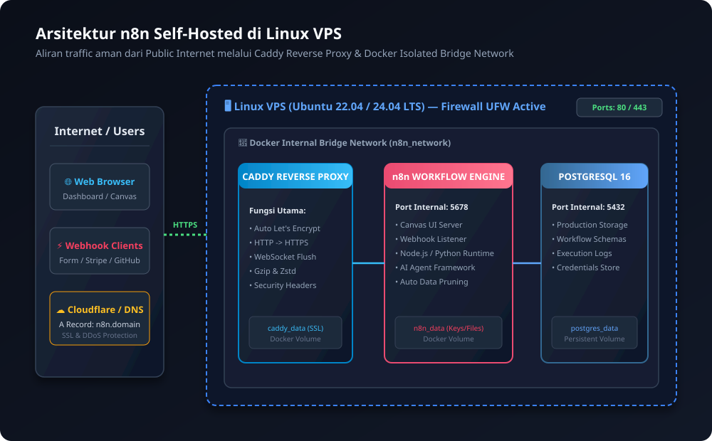
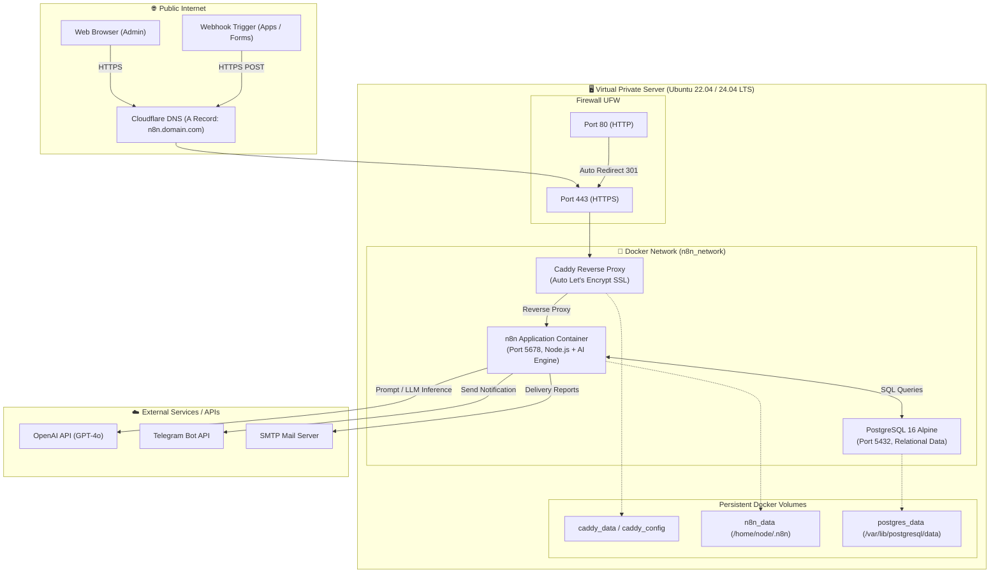
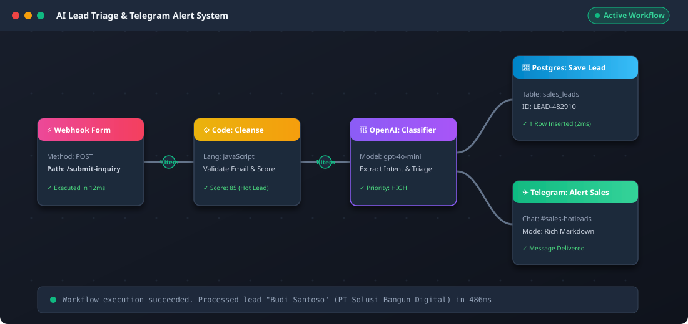

<p align="center">
  
</p>

<p align="center">
  <a href="https://n8n.io"></a>
  <a href="https://www.docker.com"></a>
  <a href="https://www.postgresql.org"></a>
  <a href="https://caddyserver.com"></a>
  <a href="https://ubuntu.com"></a>
</p>

<p align="center">
  <b>Tutorial komprehensif implementasi self-hosted n8n pada Virtual Private Server (VPS) Linux dengan Docker Compose, reverse proxy Caddy ber-SSL otomatis, database PostgreSQL 16, optimasi performa, skrip pemeliharaan periodik, dan automasi bisnis berbasis AI.</b>
</p>

---

## 📑 Daftar Isi

- [Aplikasi / Web "n8n"](#-aplikasi--web-n8n)
- [Sekilas Tentang](#-sekilas-tentang)
  - [Mengapa Self-Hosted di VPS?](#mengapa-self-hosted-di-vps)
  - [Arsitektur Sistem](#arsitektur-sistem)
- [Instalasi](#-instalasi)
  - [Prasyarat Sistem](#1-prasyarat-sistem)
  - [Langkah Instalasi dalam CLI](#2-langkah-instalasi-dalam-cli)
- [Konfigurasi Lanjutan](#-konfigurasi-lanjutan)
  - [Optimasi Server & Resource](#1-optimasi-server--kinerja)
  - [Plugin & Integrasi Eksternal](#2-plugin--integrasi-eksternal)
- [Maintenance & Pemeliharaan](#-maintenance--pemeliharaan)
  - [Pencadangan Database Otomatis](#1-backup-database-periodik-mingguan)
  - [Pembersihan Sampah & Log Rotation](#2-pembersihan-sampah-harian--log-rotation)
  - [Prosedur Pemulihan (Disaster Recovery)](#3-prosedur-restore-database)
- [Otomatisasi Skrip](#-otomatisasi-skrip-shell)
- [Cara Pemakaian](#-cara-pemakaian)
  - [Tampilan Antarmuka Aplikasi Web](#1-tampilan-antarmuka-aplikasi-web)
  - [Fungsi-Fungsi Utama](#2-fungsi-fungsi-utama)
  - [Studi Kasus Nyata (Data Real / Dummy)](#3-studi-kasus-nyata-lead-triage-ai--telegram-alert)
- [Pembahasan](#-pembahasan)
  - [Pendapat & Review Penulis](#1-pendapat-dan-evaluasi)
  - [Kelebihan](#2-kelebihan)
  - [Kekurangan](#3-kekurangan)
  - [Tabel Perbandingan dengan Aplikasi Sejenis](#4-tabel-perbandingan-komprehensif)
- [Referensi](#-referensi)

---

## 🚀 Aplikasi / Web "n8n"

**n8n** (*nodemation*) adalah platform integrasi sistem dan otomasi alur kerja (*workflow automation*) berbasis node sumber terbuka (*fair-code*) dengan pendekatan *low-code/no-code*. n8n memungkinkan individu, pengembang, maupun korporasi untuk menghubungkan ratusan aplikasi, database, webhook, API kustom, hingga model kecerdasan buatan (*AI Agents / LLMs*) ke dalam satu kanvas visual yang intuitif.

---

## 📖 Sekilas Tentang

Otomasi alur kerja modern sering kali terkendala oleh biaya langganan SaaS berbasis konsumsi task (seperti Zapier atau Make) yang membengkak seiring pertumbuhan volume transaksi data, serta regulasi kepatuhan data (*data residency & privacy*). n8n hadir sebagai alternatif mandiri (*self-hosted*) yang memberikan kendali 100% atas infrastruktur dan data tanpa batasan jumlah eksekusi.

### Mengapa Self-Hosted di VPS?

| Aspek | Layanan SaaS Proprietary (Zapier / Make) | Self-Hosted n8n di VPS |
| :--- | :--- | :--- |
| **Biaya Eksekusi** | Berbayar per-task (ribuan transaksi = ratusan USD/bulan) | **Tetap / Flat** (hanya biaya VPS ~$4 - $10/bulan) |
| **Kerahasiaan Data** | Data pelanggan diproses di server pihak ketiga | **Tersimpan lokal & terenkripsi** di database VPS sendiri |
| **Waktu Eksekusi** | Dibatasi timeout ketat (15 - 300 detik) | **Bisa diatur bebas** (cocok untuk batching data berat) |
| **Kemampuan Coding** | Terbatas pada sandbox JavaScript minimalis | **Mendukung eksekusi penuh JavaScript & Python** serta modul npm |
| **Dukungan AI Native** | Add-on berbayar tambahan | **Built-in LangChain nodes** (OpenAI, Anthropic, Ollama lokal) |

### Arsitektur Sistem

Implementasi n8n pada panduan ini menggunakan arsitektur containerized Docker dengan reverse proxy Caddy untuk menangani enkripsi TLS/SSL secara otomatis:

<p align="center">
  
</p>



---

## 🛠️ Instalasi

### 1. Prasyarat Sistem

Sebelum memulai instalasi, persiapkan komponen berikut:

- **Virtual Private Server (VPS)**:
  - Rekomendasi penyedia: DigitalOcean, Hetzner, Linode, AWS EC2, atau VPS lokal (IDCloudHost / Biznet).
  - **Spesifikasi Minimum**: 1 vCPU, 2 GB RAM, 25 GB SSD/NVMe Storage.
  - **Spesifikasi Rekomendasi**: 2 vCPU, 4 GB RAM, 40 GB NVMe (sangat ideal untuk workflow AI dan database).
- **Sistem Operasi**: Ubuntu 22.04 LTS atau 24.04 LTS (x86_64).
- **Domain / Subdomain Aktif**: Contoh: `n8n.domainanda.com`.
  - Buat **A Record** pada DNS management (Cloudflare / Namecheap / dll) mengarah ke **IP Public VPS Anda**.
  - Nonaktifkan sementara proxy orange Cloudflare (gunakan *DNS Only*) saat setup pertama kali agar validasi challenge sertifikat Caddy Let's Encrypt berjalan mulus.
- **Port Terbuka**: Port `80` (HTTP), `443` (HTTPS), dan `22` (SSH).

---

### 2. Langkah Instalasi dalam CLI

Ikuti langkah-langkah CLI berikut secara terurut:

#### Langkah 1: Akses SSH & Update Sistem

Login ke VPS Anda via terminal:

```bash
ssh root@<IP_PUBLIC_VPS_ANDA>
```

Lakukan pembaruan indeks paket dan upgrade sistem operasi:

```bash
apt update && apt upgrade -y
apt install -y curl wget git ufw htop ca-certificates gnupg lsb-release
```

#### Langkah 2: Konfigurasi 2GB Swap Memory (Wajib untuk 1-2GB RAM)

Swap memory mencegah container n8n mengalami crash (*Out-of-Memory / OOM Killer*) saat mengeksekusi workflow berukuran besar:

```bash
# Periksa apakah swap sudah aktif
swapon --show

# Jika belum ada, buat 2GB swap file
fallocate -l 2G /swapfile
chmod 600 /swapfile
mkswap /swapfile
swapon /swapfile

# Jadikan swap permanen setelah reboot
echo '/swapfile none swap sw 0 0' >> /etc/fstab

# Optimasi swappiness
sysctl vm.swappiness=10
echo 'vm.swappiness=10' >> /etc/sysctl.conf
```

#### Langkah 3: Konfigurasi Firewall Server (UFW)

Amankan server dengan membuka hanya port penting:

```bash
ufw default deny incoming
ufw default allow outgoing
ufw allow 22/tcp comment 'SSH Port'
ufw allow 80/tcp comment 'Caddy HTTP'
ufw allow 443/tcp comment 'Caddy HTTPS'
ufw --force enable
ufw status verbose
```

#### Langkah 4: Instalasi Docker & Docker Compose v2

Gunakan instalasi resmi script convenience Docker:

```bash
curl -fsSL https://get.docker.com -o get-docker.sh
sh get-docker.sh
rm get-docker.sh

# Aktifkan dan jalankan docker service
systemctl enable --now docker

# Verifikasi versi terpasang
docker --version
docker compose version
```

#### Langkah 5: Pembuatan Direktori Proyek & Berkas Konfigurasi

Buat direktori khusus untuk meletakkan file konfigurasi:

```bash
mkdir -p /opt/n8n/local_files /opt/n8n/backups
cd /opt/n8n
```

Unduh atau buat file `.env`, `docker-compose.yml`, dan `Caddyfile`.

##### A. Membuat File `.env`

Jalankan perintah berikut untuk meng-generate encryption key acak 48-karakter dan password database:

```bash
# Generate encryption key aman
N8N_KEY=$(openssl rand -hex 24)
PG_PASS=$(openssl rand -base64 16 | tr -dc 'a-zA-Z0-9' | head -c 16)

cat <<EOF > /opt/n8n/.env
# Domain & SSL
SUBDOMAIN=n8n
DOMAIN_NAME=domainanda.com
SSL_EMAIL=admin@domainanda.com
GENERIC_TIMEZONE=Asia/Jakarta

# Database PostgreSQL
POSTGRES_USER=n8n_admin
POSTGRES_PASSWORD=${PG_PASS}
POSTGRES_DB=n8n_production

# Keamanan n8n
N8N_ENCRYPTION_KEY=${N8N_KEY}

# Limitasi & Resource
N8N_PAYLOAD_SIZE_MAX=128
EXECUTIONS_DATA_PRUNE=true
EXECUTIONS_DATA_MAX_AGE=168
EXECUTIONS_DATA_PRUNE_MAX_COUNT=50000

# Logging
N8N_LOG_LEVEL=info
N8N_DIAGNOSTICS_ENABLED=false
EOF
```

> [!IMPORTANT]
> Sesuaikan nilai `SUBDOMAIN`, `DOMAIN_NAME`, dan `SSL_EMAIL` dengan domain dan email asli Anda menggunakan nano: `nano /opt/n8n/.env`. Catat `N8N_ENCRYPTION_KEY` di password manager Anda!

##### B. Membuat File `Caddyfile`

Caddy bertindak sebagai reverse proxy otomatis yang meminta dan memperbarui sertifikat HTTPS dari Let's Encrypt tanpa perlu konfigurasi certbot manual:

```bash
cat <<'EOF' > /opt/n8n/Caddyfile
{$SUBDOMAIN}.{$DOMAIN_NAME} {
    reverse_proxy n8n:5678 {
        flush_interval -1
    }

    header {
        Strict-Transport-Security "max-age=31536000; includeSubDomains; preload"
        X-Content-Type-Options "nosniff"
        X-Frame-Options "SAMEORIGIN"
        X-XSS-Protection "1; mode=block"
        Referrer-Policy "strict-origin-when-cross-origin"
    }

    tls {$SSL_EMAIL}
    encode gzip zstd
}
EOF
```

##### C. Membuat File `docker-compose.yml`

File orkestrasi container production:

```bash
cat <<'EOF' > /opt/n8n/docker-compose.yml
version: '3.8'

services:
  caddy:
    image: caddy:2-alpine
    container_name: n8n_caddy
    restart: unless-stopped
    ports:
      - "80:80"
      - "443:443"
    volumes:
      - ./Caddyfile:/etc/caddy/Caddyfile:ro
      - caddy_data:/data
      - caddy_config:/config
    networks:
      - n8n_network
    depends_on:
      - n8n

  postgres:
    image: postgres:16-alpine
    container_name: n8n_postgres
    restart: unless-stopped
    environment:
      POSTGRES_USER: ${POSTGRES_USER}
      POSTGRES_PASSWORD: ${POSTGRES_PASSWORD}
      POSTGRES_DB: ${POSTGRES_DB}
    volumes:
      - postgres_data:/var/lib/postgresql/data
    networks:
      - n8n_network
    healthcheck:
      test: ["CMD-SHELL", "pg_isready -h localhost -U ${POSTGRES_USER} -d ${POSTGRES_DB}"]
      interval: 5s
      timeout: 5s
      retries: 10

  n8n:
    image: docker.n8n.io/n8nio/n8n:latest
    container_name: n8n_app
    restart: unless-stopped
    environment:
      - N8N_HOST=${SUBDOMAIN}.${DOMAIN_NAME}
      - N8N_PORT=5678
      - N8N_PROTOCOL=https
      - WEBHOOK_URL=https://${SUBDOMAIN}.${DOMAIN_NAME}/
      - GENERIC_TIMEZONE=${GENERIC_TIMEZONE}
      - TZ=${GENERIC_TIMEZONE}

      # Database PostgreSQL
      - DB_TYPE=postgresdb
      - DB_POSTGRESDB_HOST=postgres
      - DB_POSTGRESDB_PORT=5432
      - DB_POSTGRESDB_DATABASE=${POSTGRES_DB}
      - DB_POSTGRESDB_USER=${POSTGRES_USER}
      - DB_POSTGRESDB_PASSWORD=${POSTGRES_PASSWORD}

      # Keamanan
      - N8N_ENCRYPTION_KEY=${N8N_ENCRYPTION_KEY}

      # Optimasi & Pruning
      - EXECUTIONS_DATA_PRUNE=${EXECUTIONS_DATA_PRUNE}
      - EXECUTIONS_DATA_MAX_AGE=${EXECUTIONS_DATA_MAX_AGE}
      - EXECUTIONS_DATA_PRUNE_MAX_COUNT=${EXECUTIONS_DATA_PRUNE_MAX_COUNT}
      - N8N_PAYLOAD_SIZE_MAX=${N8N_PAYLOAD_SIZE_MAX}

      # Ekstensi & Modul Eksternal
      - N8N_COMMUNITY_PACKAGES_ENABLED=true
      - NODE_FUNCTION_ALLOW_EXTERNAL=lodash,axios,moment,crypto-js

      # Logging
      - N8N_LOG_LEVEL=${N8N_LOG_LEVEL}
      - N8N_DIAGNOSTICS_ENABLED=${N8N_DIAGNOSTICS_ENABLED}
    volumes:
      - n8n_data:/home/node/.n8n
      - ./local_files:/data/local_files
    networks:
      - n8n_network
    depends_on:
      postgres:
        condition: service_healthy
    deploy:
      resources:
        limits:
          memory: 2048M
        reservations:
          memory: 512M

volumes:
  caddy_data:
  caddy_config:
  postgres_data:
  n8n_data:

networks:
  n8n_network:
    driver: bridge
EOF
```

#### Langkah 6: Menjalankan Container

Tarik seluruh image dan jalankan stack di background:

```bash
cd /opt/n8n
docker compose pull
docker compose up -d
```

Verifikasi bahwa ketiga container berjalan dalam status `Up` / `healthy`:

```bash
docker compose ps
```

Hasil terminal yang diharapkan:
```text
NAME           IMAGE                             COMMAND                  SERVICE    STATUS                    PORTS
n8n_app        docker.n8n.io/n8nio/n8n:latest    "tini -- /docker-ent…"   n8n        running (healthy)         5678/tcp
n8n_caddy      caddy:2-alpine                    "caddy run --config …"   caddy      running                   0.0.0.0:80->80/tcp, 0.0.0.0:443->443/tcp
n8n_postgres   postgres:16-alpine                "docker-entrypoint.s…"   postgres   running (healthy)         5432/tcp
```

Periksa log Caddy untuk memastikan sertifikat SSL berhasil digenerate:

```bash
docker compose logs caddy | grep -i "certificate obtained"
```

Buka peramban (*web browser*) Anda dan akses:
👉 `https://n8n.domainanda.com`

---

## ⚙️ Konfigurasi Lanjutan

### 1. Optimasi Server & Kinerja

Secara default, n8n menyimpan riwayat eksekusi setiap detik. Tanpa konfigurasi batas, disk VPS akan cepat penuh dan memori PostgreSQL akan meluap.

#### A. Batas Ukuran Payload Upload File (`N8N_PAYLOAD_SIZE_MAX`)
Jika workflow Anda mengolah file binary (seperti PDF, gambar, atau audio rekaman meeting untuk transkrip Whisper), tingkatkan batas payload:
```env
# Batas ukuran payload file masuk (dalam MB, default adalah 16MB)
N8N_PAYLOAD_SIZE_MAX=128
```

#### B. Pembersihan Otomatis Riwayat Eksekusi (*Execution Data Pruning*)
Aktifkan variabel berikut pada file `.env`:
```env
# Aktifkan auto-prune
EXECUTIONS_DATA_PRUNE=true

# Batas usia penyimpanan histori eksekusi dalam jam (168 jam = 7 hari)
EXECUTIONS_DATA_MAX_AGE=168

# Batasi jumlah maksimal entri eksekusi yang disimpan di database
EXECUTIONS_DATA_PRUNE_MAX_COUNT=50000

# Jangan simpan payload detail jika eksekusi berhasil (hanya simpan jika gagal/error)
# Menghemat kapasitas database hingga 80%!
EXECUTIONS_DATA_SAVE_ON_ERROR=all
EXECUTIONS_DATA_SAVE_ON_SUCCESS=none
```

#### C. Alokasi Batas Memori Container (Resource Limiting)
Agar proses n8n tidak mengambil 100% kapasitas RAM server saat ada request berat, atur batas memori pada `docker-compose.yml`:
```yaml
deploy:
  resources:
    limits:
      memory: 2048M
    reservations:
      memory: 512M
```

#### D. Pengaturan Zona Waktu (*Timezone*)
Agar node Schedule / Cron Trigger mengeksekusi workflow sesuai waktu lokal Indonesia:
```env
GENERIC_TIMEZONE=Asia/Jakarta
TZ=Asia/Jakarta
```

---

### 2. Plugin & Integrasi Eksternal

#### A. Community Nodes (Plugin Ekstensi Komunitas)
n8n mendukung ekosistem node buatan komunitas (misal: node WhatsApp Baileys, PDF Creator, MinIO Storage, dll).
1. Pastikan env terpasang:
   ```env
   N8N_COMMUNITY_PACKAGES_ENABLED=true
   ```
2. Buka Web UI n8n ➔ **Settings** ➔ **Community Nodes** ➔ Klik **Install a node**.
3. Masukkan nama package npm yang diinginkan, misalnya `n8n-nodes-whatsapp-baileys` atau `n8n-nodes-pdfkit`.

#### B. Izinkan Modul Eksternal di Node Code (JavaScript / Python)
Secara default, node Code berjalan dalam sandbox terbatas. Untuk menggunakan library seperti `lodash`, `axios`, atau `moment`:
```env
NODE_FUNCTION_ALLOW_EXTERNAL=lodash,axios,moment,crypto-js
```

#### C. Autentikasi Pengguna & Email Reset Password (SMTP)
Agar n8n dapat mengirim email aktivasi anggota tim dan reset password:
Tambahkan pada service `n8n` di `docker-compose.yml`:
```yaml
environment:
  - N8N_EMAIL_MODE=smtp
  - N8N_SMTP_HOST=smtp.gmail.com
  - N8N_SMTP_PORT=587
  - N8N_SMTP_USER=notifikasi.bisnis@gmail.com
  - N8N_SMTP_PASS=xxxx-xxxx-xxxx-xxxx # App Password Gmail
  - N8N_SMTP_SENDER=n8n Automation <notifikasi.bisnis@gmail.com>
  - N8N_SMTP_SSL=false
```

#### D. Integrasi Single Sign-On (Google / OAuth)
Anda dapat menghubungkan Google OAuth Credential untuk memudahkan anggota workspace login menggunakan akun Google Workspace / Gmail perusahaan, serta mengakses Google Sheets, Gmail, dan Google Drive langsung dari kanvas tanpa harus membuat OAuth app berulang kali.

---

## 🛡️ Maintenance & Pemeliharaan

Pemeliharaan server mandiri wajib direncanakan agar data alur kerja bisnis tidak hilang jika server VPS mengalami kegagalan hardware.

### 1. Backup Database Periodik Mingguan

Buat skrip pencadangan PostgreSQL dan encryption key di `/opt/n8n/scripts/backup-n8n.sh`:

```bash
mkdir -p /opt/n8n/scripts
cat <<'EOF' > /opt/n8n/scripts/backup-n8n.sh
#!/usr/bin/env bash
set -euo pipefail

INSTALL_DIR="/opt/n8n"
BACKUP_DIR="${INSTALL_DIR}/backups"
TIMESTAMP=$(date +"%Y%m%d_%H%M%S")
RETENTION_DAYS=14

mkdir -p "${BACKUP_DIR}"
source "${INSTALL_DIR}/.env"

echo "[$(date)] Memulai pencadangan n8n..."

# 1. Dump database PostgreSQL terkompresi
docker exec n8n_postgres pg_dump -U "${POSTGRES_USER}" -d "${POSTGRES_DB}" | gzip > "${BACKUP_DIR}/n8n_db_${TIMESTAMP}.sql.gz"

# 2. Backup file environment & konfigurasi
tar -czf "${BACKUP_DIR}/n8n_config_${TIMESTAMP}.tar.gz" -C "${INSTALL_DIR}" .env Caddyfile docker-compose.yml

# 3. Rotasi: Hapus backup yang lebih lama dari 14 hari
find "${BACKUP_DIR}" -name "n8n_db_*.sql.gz" -mtime +"${RETENTION_DAYS}" -delete
find "${BACKUP_DIR}" -name "n8n_config_*.tar.gz" -mtime +"${RETENTION_DAYS}" -delete

echo "[SUCCESS] Backup berhasil disimpan di ${BACKUP_DIR}"
EOF

chmod +x /opt/n8n/scripts/backup-n8n.sh
```

#### Jadwalkan via Cron Job (Setiap Minggu Jam 02:00 WIB)
Buka crontab:
```bash
crontab -e
```
Tambahkan baris berikut di paling bawah:
```cron
0 2 * * 0 /opt/n8n/scripts/backup-n8n.sh >> /var/log/n8n_backup.log 2>&1
```

---

### 2. Pembersihan Sampah Harian & Log Rotation

#### A. Docker System Prune Otomatis (Tiap Hari Jam 03:30 WIB)
Docker secara akumulatif menumpuk dangling images dan build cache. Tambahkan ke `crontab -e`:
```cron
30 3 * * * docker system prune -f >> /var/log/docker_prune.log 2>&1
```

#### B. Mencegah Docker Daemon Log Membengkak
Buat berkas konfig `/etc/docker/daemon.json` untuk membatasi ukuran file log container maksimal 20MB:
```json
{
  "log-driver": "json-file",
  "log-opts": {
    "max-size": "20m",
    "max-file": "3"
  }
}
```
Lalu muat ulang Docker daemon:
```bash
systemctl restart docker
```

---

### 3. Prosedur Restore Database

Jika terjadi insiden dan Anda perlu memulihkan database dari snapshot:

```bash
# 1. Matikan container n8n sementara
cd /opt/n8n && docker compose stop n8n

# 2. Salin dan restore file dump .sql.gz ke PostgreSQL
gunzip -c /opt/n8n/backups/n8n_db_YYYYMMDD_HHMMSS.sql.gz | docker exec -i n8n_postgres psql -U n8n_admin -d n8n_production

# 3. Jalankan kembali container n8n
docker compose start n8n
```

---

## 🤖 Otomatisasi Skrip Shell

Repositori ini menyertakan skrip otomatis siap pakai pada direktori `scripts/`:

| Nama Skrip | Fungsi | Perintah Eksekusi |
| :--- | :--- | :--- |
| [`scripts/setup-n8n.sh`](file:///c:/KDJK/KDJK-hosting/scripts/setup-n8n.sh) | **1-Click Auto Installer**: Menginstal Docker, swap, firewall, men-generate key rahasia, dan menyalakan n8n | `bash scripts/setup-n8n.sh` |
| [`scripts/backup-n8n.sh`](file:///c:/KDJK/KDJK-hosting/scripts/backup-n8n.sh) | **Pencadangan Otomatis**: Dump database PostgreSQL & kompresi file konfigurasi dengan retensi 14 hari | `bash scripts/backup-n8n.sh` |
| [`scripts/update-n8n.sh`](file:///c:/KDJK/KDJK-hosting/scripts/update-n8n.sh) | **Safe Auto-Updater**: Menjalankan snapshot cadangan darurat, menarik image Docker terbaru, dan restart zero-downtime | `bash scripts/update-n8n.sh` |

---

## 🖥️ Cara Pemakaian

### 1. Tampilan Antarmuka Aplikasi Web

Setelah membuka `https://n8n.domainanda.com`, Anda akan disajikan dengan antarmuka grafis yang bersih dan modern:

<p align="center">
  
</p>

- **Navigation Sidebar (Kiri)**: Akses cepat ke repositori *Workflows*, riwayat *Executions*, brankas *Credentials*, *Variables*, dan pengaturan admin.
- **Canvas Visual (Tengah)**: Ruang kerja drag-and-drop untuk merangkai alur kerja data dari trigger hingga action node.
- **Node Configuration Panel (Kanan)**: Pengaturan parameter detail, ekspresi formula dinamik `{{ $json.field }}`, dan simulasi live output.

---

### 2. Fungsi-Fungsi Utama

| Kategori Node | Fungsi Utama | Contoh Node Populer |
| :--- | :--- | :--- |
| **Triggers** | Memulai workflow berdasarkan waktu atau event masuk | Webhook (HTTP POST/GET), Schedule (Cron), IMAP Email Received, Telegram Trigger |
| **Data Transform** | Memfilter, menggabungkan, memodifikasi, dan menghitung data | Code (JavaScript/Python), Filter, Switch, Merge, Set/Edit Fields, Split In Batches |
| **AI & LLM** | Menjalankan penalaran berbasis model bahasa besar | OpenAI, Anthropic Claude, AI Agent (ReAct Framework), Vector Store (Pinecone/Qdrant) |
| **Databases** | Membaca dan menulis data transaksi | PostgreSQL, MySQL, Supabase, Redis, MongoDB |
| **Communication** | Mengirimkan notifikasi dan laporan ke tim | Telegram, WhatsApp Gateway, Slack, Discord, Gmail / SMTP |

---

### 3. Studi Kasus Nyata: Lead Triage AI & Telegram Alert

Berikut adalah demonstrasi alur kerja **produksi nyata** (bukan template kosong) yang menghubungkan Formulir Penjualan Landing Page dengan AI Classifier dan Notifikasi Telegram Tim Sales.

File alur kerja lengkap dapat diimpor langsung melalui menu **Workflows ➔ Import from File**:
📂 [`workflows/lead-triage-ai-telegram.json`](file:///c:/KDJK/KDJK-hosting/workflows/lead-triage-ai-telegram.json)

#### Visual Alur Kerja Canvas:
<p align="center">
  
</p>

#### Skenario & Data Eksekusi Real:

##### 1. Input Data Webhook Masuk (Dummy Data Realistis):
Klien mengisi form konsultasi pada landing page perusahaan:
```json
{
  "headers": {
    "host": "n8n.domainanda.com",
    "content-type": "application/json"
  },
  "body": {
    "full_name": "Budi Santoso",
    "email": "budi.santoso@startupindonesia.co.id",
    "company": "PT Solusi Bangun Digital",
    "budget_usd": 3500,
    "phone": "+6281234567890",
    "message": "Halo, kami butuh integrasi backend database CRM kami dengan WhatsApp Business API dan notifikasi ke channel Telegram tim dalam deadline 2 pekan."
  }
}
```

##### 2. Pemrosesan Data di Node Code (JavaScript):
Data divalidasi, dibersihkan dari spasi berlebih, dan dihitung skor kelayakannya:
```javascript
const input = $json.body || $json;

const fullName = (input.full_name || 'Anonymous').trim();
const email = (input.email || '').toLowerCase();
const budgetUsd = Number(input.budget_usd) || 0;
const isCorporate = !email.endsWith('@gmail.com') && !email.endsWith('@yahoo.com');

return [{
  json: {
    lead_id: 'LEAD-' + Math.floor(100000 + Math.random() * 900000),
    full_name: fullName,
    email: email,
    company: input.company || 'Perorangan',
    budget_usd: budgetUsd,
    is_corporate_email: isCorporate,
    preliminary_score: (budgetUsd >= 3000 && isCorporate) ? 90 : 50,
    raw_inquiry: input.message,
    submitted_at: new Date().toISOString()
  }
}];
```

##### 3. Klasifikasi Cerdas di Node OpenAI (GPT-4o-mini):
AI menganalisis niat dan tingkat urgensi klien:
```json
{
  "priority": "HIGH",
  "classification": "HOT LEAD",
  "executive_summary": "Klien korporat memiliki budget memadai ($3,500) dengan kebutuhan mendesak untuk integrasi CRM, WhatsApp API, dan Telegram dalam waktu 14 hari.",
  "suggested_solution": "Tawarkan paket implementasi Custom API Automation n8n Enterprise dengan modul WhatsApp Baileys dan SLA integrasi kilat."
}
```

##### 4. Penyimpanan ke Database PostgreSQL:
Data disimpan ke tabel `sales_leads` di PostgreSQL lokal VPS (Query waktu eksekusi: **2 ms**).

##### 5. Pengiriman Notifikasi Rich Alert ke Telegram:
Pesan yang otomatis diterima tim sales di grup Telegram:

```text
🚨 NEW HOT LEAD DETECTED! 🚨

👤 Klien: Budi Santoso (PT Solusi Bangun Digital)
📧 Email: budi.santoso@startupindonesia.co.id
💰 Budget: $3,500
🔥 Status: HOT LEAD (Priority: HIGH)

📝 Analisis AI:
Klien korporat memiliki budget memadai ($3,500) dengan kebutuhan mendesak untuk integrasi CRM, WhatsApp API, dan Telegram dalam waktu 14 hari.

💡 Saran Solusi:
Tawarkan paket implementasi Custom API Automation n8n Enterprise dengan modul WhatsApp Baileys dan SLA integrasi kilat.

🆔 Lead ID: LEAD-849201
```

---

## 💬 Pembahasan

### 1. Pendapat dan Evaluasi

Setelah menguji dan mengoperasikan n8n versi self-hosted di lingkungan VPS produksi, platform ini membuktikan dirinya sebagai solusi otomasi alur kerja paling seimbang di industri saat ini. n8n menggabungkan kesederhanaan antarmuka *no-code* dengan fleksibilitas manipulasi objek data tingkat lanjut (*code-first mindset*). Bagi tim teknis maupun bisnis yang ingin mengotomasi proses berulang tanpa terikat tagihan biaya tak terduga dari vendor SaaS, n8n self-hosted adalah investasi infrastruktur terbaik.

### 2. Kelebihan

- ✅ **Biaya Tetap & Tanpa Batas Eksekusi**: Menjalankan 10 eksekusi per hari maupun 500.000 eksekusi per hari memakan biaya yang sama persis (hanya biaya sewa VPS Anda).
- ✅ **Kedaulatan & Keamanan Data (100% On-Premise)**: Seluruh kredensial API dan database konsumen tersimpan terenkripsi di VPS lokal, patuh terhadap regulasi GDPR dan UU Perlindungan Data Pribadi (UU PDP).
- ✅ **Dukungan Native AI Agent**: Framework LangChain bawaan memudahkan orkestrasi memory agent, tool calling, dan RAG tanpa perlu setup library python rumit dari awal.
- ✅ **Dapat Dimodifikasi dengan Kode Kustom**: Dukungan eksekusi JavaScript modern dan skrip Python langsung di dalam kanvas alur kerja.
- ✅ **Ekosistem Komunitas yang Solid**: Ratusan template siap pakai dan custom node buatan komunitas terus bertambah setiap minggu.

### 3. Kekurangan

- ❌ **Tanggung Jawab Pemeliharaan Mandiri**: Pengguna bertanggung jawab penuh atas pembaruan sistem operasi server, sertifikat domain, dan pencadangan database.
- ❌ **Konsumsi Memori RAM Relatif Tinggi**: Karena dibangun di atas Node.js dan Chromium/Puppeteer (bila menggunakan browser automasi), n8n membutuhkan minimal 2GB RAM untuk beroperasi stabil.
- ❌ **Perlu Mode Queue (Redis) untuk Skala Masif**: Untuk beban kerja di atas 100 webhook per detik secara bersamaan, konfigurasi default single-instance harus diubah menjadi n8n Queue Mode dengan Redis dan multiple worker nodes.

---

### 4. Tabel Perbandingan Komprehensif

| Fitur / Parameter | **n8n (Self-Hosted VPS)** | **Zapier (Cloud SaaS)** | **Make / Integromat** | **Activepieces (Self-Hosted)** |
| :--- | :--- | :--- | :--- | :--- |
| **Model Lisensi** | Sustainable Use License (Fair-code) | Proprietary Closed-source | Proprietary Closed-source | MIT Open Source |
| **Opsi Hosting** | **Self-Hosted (VPS / On-Premise / Cloud)** | Hanya Cloud SaaS | Hanya Cloud SaaS | Self-Hosted & Cloud |
| **Estimasi Biaya Bulanan** | **$4 - $10 / bulan (Flat VPS)** | $29.99 - $599+ / bulan | $10.59 - $299+ / bulan | $5 - $10 / bulan (VPS) |
| **Batas Task / Eksekusi** | **UNLIMITED (Tanpa batas)** | 750 s/d 100.000 task/bln | 10.000 s/d 120.000 ops/bln | **UNLIMITED** |
| **Eksekusi Kode** | **JavaScript & Python Lengkap** | JavaScript / Python terbatas | Formula fungsi saja | TypeScript minimalis |
| **Integrasi AI Agent** | **Sangat Luas (LangChain & RAG)** | Tambahan fitur berbayar | OpenAI Module standar | AI Flow dasar |
| **Privasi Data** | **Tinggi (Server milik sendiri)** | Rendah (Server pihak ketiga) | Rendah (Server pihak ketiga) | **Tinggi (Server sendiri)** |
| **Kebutuhan DevOps** | **Perlu (Docker & Linux dasar)** | Zero DevOps | Zero DevOps | Perlu (Docker) |

---

## 📚 Referensi

Panduan ini disusun berdasarkan dokumentasi resmi dan best-practices industri terkini:

1. **Dokumentasi Resmi n8n**:
   - [n8n Official Documentation](https://docs.n8n.io/)
   - [Hosting n8n with Docker Compose](https://docs.n8n.io/hosting/installation/docker-compose/)
   - [n8n Environment Variables Configuration](https://docs.n8n.io/hosting/configuration/environment-variables/)
2. **Repositori Source Code**:
   - [GitHub n8n-io/n8n](https://github.com/n8n-io/n8n)
3. **Infrastruktur & Reverse Proxy**:
   - [Caddy Web Server Documentation - Reverse Proxy Quickstart](https://caddyserver.com/docs/quick-starts/reverse-proxy)
   - [Docker Official Documentation](https://docs.docker.com/)
   - [PostgreSQL 16 Official Manual](https://www.postgresql.org/docs/16/index.html)
4. **Keamanan Server Linux**:
   - [Ubuntu Server Security & UFW Best Practices](https://ubuntu.com/server/docs/security-firewall)
   - [CIS Ubuntu Linux Benchmark Guide](https://www.cisecurity.org/benchmark/ubuntu_linux)

---

<p align="center">
  Dibuat dengan dedikasi untuk komunitas automasi & pengembang Indonesia 🇮🇩<br>
  <i>Empower your business workflows with true freedom and self-hosted privacy.</i>
</p>
