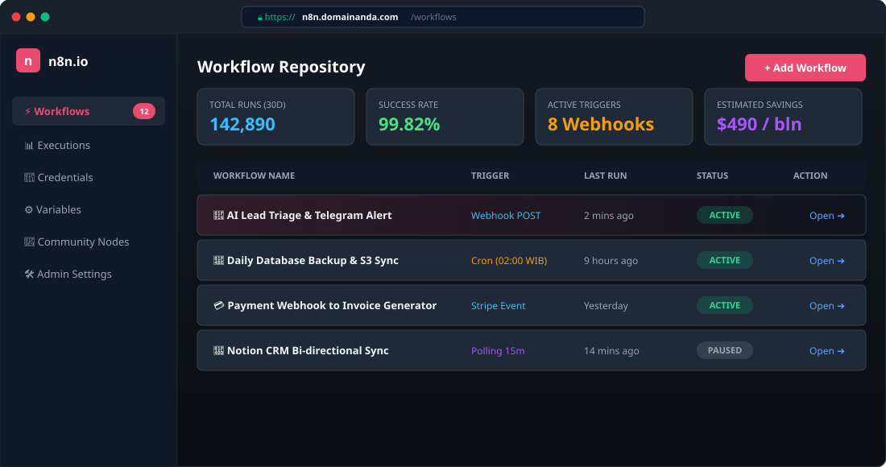
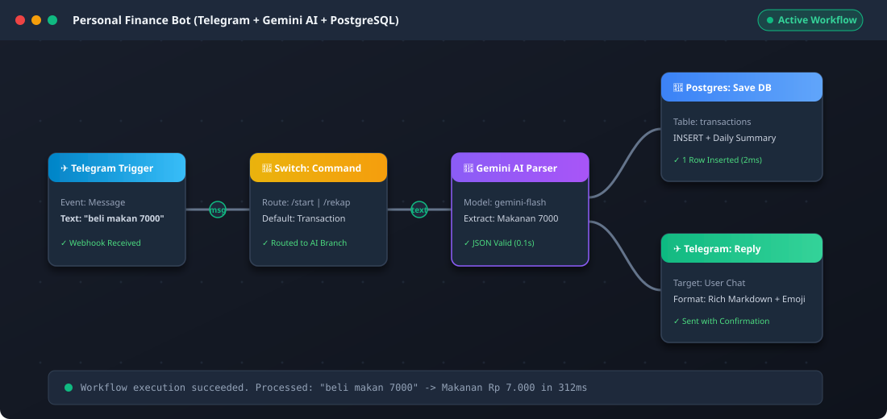

<p align="center">
  
</p>

<p align="center">
  <b>Telegram Client</b> ➔ <b>Caddy (HTTPS/TLS)</b> ➔ <b>n8n Workflow Engine</b> ➔ <b>Google Gemini AI</b> ➔ <b>PostgreSQL 16</b>
  <br>
  <i>Integrasi alur komunikasi data otomatis untuk pencatatan transaksi keuangan personal secara cerdas, aman, dan mandiri.</i>
</p>

---

<h1 align="center">
  🪙 Self-Hosted n8n untuk Manajemen Keuangan Pribadi
</h1>

<p align="center">
  <a href="#anggota-kelompok">Anggota Kelompok</a> •
  <a href="#sekilas-tentang-n8n-money-management">Sekilas tentang (n8n-Money Management)</a> •
  <a href="#instalasi">Instalasi</a> •
  <a href="#konfigurasi">Konfigurasi</a> •
  <a href="#maintenance">Maintenance</a> •
  <a href="#otomatisasi">Otomatisasi</a> •
  <a href="#cara-pemakaian">Cara Pemakaian</a> •
  <a href="#pembahasan">Pembahasan</a> •
  <a href="#referensi">Referensi</a>
</p>

---

## Anggota Kelompok

| Kelompok 4 | Komunikasi Data dan Jaringan Komputer |
| :--- | :--- |
| **Nama** | **NIM** |
| Delvin Adithya | M0403241001 |
| Nadia Khairunisa | M0403241018 |
| Ares Krespo Oktama Purba | M0403241042 |
| Arya Faiz Maheswara A.P | M0403241044 |
| Prima Jaya Kusumah | M0403241106 |

---

## Sekilas tentang (n8n-Money Management)

**n8n-Money Management** adalah sistem asisten keuangan pribadi cerdas berbasis bot Telegram yang di-hosting mandiri (*self-hosted*) menggunakan orkestrasi kontainer Docker di server Cloud VPS Linux. Sistem ini memanfaatkan **n8n Workflow Automation** sebagai penghubung komunikasi data antara antarmuka chat Telegram, model **Google Gemini AI** untuk pemrosesan bahasa alami (*Natural Language Processing*), dan basis data relasional **PostgreSQL 16** untuk penyimpanan persisten.

Pengguna tidak perlu mengisi formulir manual yang kaku. Cukup mengirimkan pesan teks bebas seperti *"beli makan siang 15rb"* atau *"dapat transferan bonus 500rb"*, sistem akan secara otomatis mengenali jenis transaksi, mengkategorikannya, mengekstrak nilai nominal rupiah murni, lalu menyimpannya ke basis data serta memberikan umpan balik rekapitulasi secara *real-time*.

### Fitur Utama (Kelebihan):
- **Natural Language Parsing**: Memahami percakapan informal dan istilah slang finansial lokal (*rb, k, jt, perak, cepek, goceng*).
- **Resilient Fallback Parsing**: Dilengkapi mesin fallback Regex lokal otomatis jika kuota AI habis atau koneksi API eksternal terganggu, menjamin sistem tetap aktif 24/7.
- **Kedaulatan & Privasi Data Penuh**: Seluruh rekaman transaksi finansial tersimpan aman di basis data server pribadi, bebas dari pelacakan pihak ketiga.
- **Tanpa Batas Kuota Eksekusi**: Berbeda dengan platform otomasi komersial berbayar, sistem ini dapat memproses transaksi tanpa batasan volume task per bulan.
- **Transmisi Terenkripsi & Aman**: Menggunakan reverse proxy Caddy dengan sertifikat SSL/TLS otomatis dari Let's Encrypt serta isolasi jaringan Docker bridge tertutup.

---

## Instalasi

### 1. Persiapan Kebutuhan

Sebelum memulai proses instalasi, siapkan beberapa kebutuhan berikut:

| Kebutuhan | Spesifikasi / Keterangan |
| :--- | :--- |
| **Server VPS** | Cloud VPS Linux (Ubuntu 24.04 LTS direkomendasikan), min. 1 vCPU, 1 GB RAM, IP Publik statis. |
| **Domain / DDNS** | Akun gratis [DuckDNS](https://www.duckdns.org) dengan subdomain terarah ke IP VPS (contoh: `keuangan-kdjk.duckdns.org`). |
| **Bot Telegram** | HTTP Bot Token dari [@BotFather](https://t.me/BotFather) di Telegram. |
| **Google Gemini API** | API Key dari [Google AI Studio](https://aistudio.google.com). |
| **Akses Jaringan** | Hak akses root/sudo via protokol OpenSSH (port 22). |

---

### 2. Ilustrasi Alur Instalasi Sistem

```text
[Internet / User]
       │
       ▼
 [Port 80/443] ──► [UFW Firewall Host]
                          │
                          ▼
             [Caddy Ingress Reverse Proxy] (Auto SSL)
                          │ (Internal Docker Bridge: 172.20.0.0/16)
                          ├──► [n8n Workflow Engine: 5678]
                          │           │
                          │           ▼
                          │    [PostgreSQL 16: 5432] (Port Terisolasi)
                          ▼
               [DuckDNS Auto-Update via Cron]
```

---

### 3. Langkah-demi-Langkah Instalasi

#### Langkah 1: Akses Remote & Pembaruan Server
Masuk ke terminal server VPS menggunakan SSH:
```bash
ssh root@<IP_PUBLIK_VPS>
apt-get update -y && apt-get upgrade -y
apt-get install -y curl wget git ufw dnsutils
```

#### Langkah 2: Konfigurasi Keamanan Jaringan (Firewall UFW)
Terapkan kebijakan keamanan *Default-Deny*:
```bash
ufw default deny incoming
ufw default allow outgoing
ufw allow 22/tcp comment 'SSH'
ufw allow 80/tcp comment 'HTTP / ACME'
ufw allow 443/tcp comment 'HTTPS'
ufw --force enable
```

#### Langkah 3: Setup Domain Dynamic DNS (DuckDNS)
1. Buka [DuckDNS](https://www.duckdns.org), login dan buat domain, misal `keuangan-kdjk`.
2. Arahkan **Current IP** ke alamat IP publik VPS Anda.
3. Buat skrip auto-updater di VPS (`/opt/duckdns/duck.sh`) dan pasang pada crontab:
```bash
mkdir -p /opt/duckdns
cat << 'EOF' > /opt/duckdns/duck.sh
#!/usr/bin/env bash
curl -s "https://www.duckdns.org/update?domains=keuangan-kdjk&token=<TOKEN_DUCKDNS>&ip="
EOF
chmod 700 /opt/duckdns/duck.sh
(crontab -l 2>/dev/null; echo "*/5 * * * * /opt/duckdns/duck.sh >/dev/null 2>&1") | crontab -
```

#### Langkah 4: Kloning Repositori & Eksekusi Skrip Instalasi 1-Klik
```bash
git clone https://github.com/oktares/KDJK-hosting.git /tmp/KDJK-hosting
cd /tmp/KDJK-hosting
chmod +x scripts/*.sh
sudo bash scripts/setup-n8n.sh
```
Ikuti instruksi interaktif pada layar untuk memasukkan nama domain, email SSL, serta API Key.

#### Langkah 5: Verifikasi Status Kontainer
Pastikan seluruh kontainer berada dalam status `Up` / `healthy`:
```bash
cd /opt/n8n && docker compose ps
```

---

## Konfigurasi

Pengaturan disesuaikan dengan kondisi riil berkas konfigurasi repositori (`.env`, `docker-compose.yml`, dan `Caddyfile`):

### 1. Optimasi Kinerja Host & Limitasi Server
- **Alokasi Swap Memory 2GB**: Mencegah *Out-Of-Memory (OOM) Killer* pada VPS berspesifikasi RAM 1–2 GB saat n8n mengeksekusi kompilasi alur kerja:
  ```bash
  sysctl vm.swappiness=10
  ```
- **Batas Maksimal Payload Webhook**:
  ```env
  N8N_PAYLOAD_SIZE_MAX=128
  ```
  Mengizinkan pemrosesan payload data webhook atau lampiran hingga 128 MB.
- **Standarisasi Zona Waktu**:
  ```env
  GENERIC_TIMEZONE=Asia/Jakarta
  ```
  Menjamin seluruh penanggalan transaksi dicatat akurat dalam Waktu Indonesia Barat (WIB).

### 2. Konfigurasi Jaringan & Reverse Proxy Caddy
Pengaturan pada berkas `Caddyfile` menerapkan penerusan lalu lintas aman dan proteksi header keamanan HTTP:
- **Port Forwarding**: Meneruskan lalu lintas domain publik port 443 ke port internal container `n8n:5678`.
- **WebSocket Live Streaming**: Menonaktifkan buffer transmisi (`flush_interval -1`) untuk mendukung koneksi real-time n8n.
- **Security Headers Hardening**:
  - `Strict-Transport-Security`: Memaksa klien hanya berkomunikasi via HTTPS.
  - `X-Content-Type-Options: nosniff`: Mencegah eksploitasi MIME sniffing.
  - `X-Frame-Options: SAMEORIGIN`: Proteksi dari serangan Clickjacking.
- **Kompresi Data**: Mengaktifkan modul `encode gzip zstd` untuk menghemat bandwidth transmisi.

### 3. Kredensial Basis Data & Kunci Kriptografi
- **Isolasi Database**: PostgreSQL berjalan pada user-defined bridge network `n8n_network` (subnet `172.20.0.0/16`) tanpa port binding publik (port 5432 tertutup total dari internet).
- **Master Encryption Key**:
  ```env
  N8N_ENCRYPTION_KEY=d7a9b1c3e5f7a2b4c6d8e0f1a3b5c7d9e2f4a6b8c0d2e4f6
  ```
  Kunci entropi 48-karakter hex untuk mengenkripsi kredensial API eksternal di dalam n8n vault.

---

## Maintenance

Pemeliharaan sistem diatur secara periodik untuk menjaga ketersediaan sumber daya dan integritas data:

### 1. Pembersihan Otomatis Riwayat Eksekusi (Log Pruning)
Untuk mencegah disk VPS penuh akibat log riwayat eksekusi alur kerja n8n, diaktifkan kebijakan pembersihan berkala pada `.env`:
```env
EXECUTIONS_DATA_PRUNE=true
EXECUTIONS_DATA_MAX_AGE=168
EXECUTIONS_DATA_PRUNE_MAX_COUNT=50000
```
*Data eksekusi yang telah berumur lebih dari 7 hari (168 jam) akan dibersihkan secara otomatis.*

### 2. Backup Otomatis Database & Konfigurasi (`backup-n8n.sh`)
Skrip [`scripts/backup-n8n.sh`](scripts/backup-n8n.sh) mencadangkan seluruh data penting:
1. Mengekspor *dump* database PostgreSQL terkompresi: `n8n_db_YYYYMMDD_HHMMSS.sql.gz`.
2. Mengarsipkan berkas konfigurasi `.env`, `docker-compose.yml`, `Caddyfile`, dan alur kerja n8n: `n8n_env_YYYYMMDD_HHMMSS.tar.gz`.
3. **Kebijakan Retensi 14 Hari**: Menghapus file backup lama yang berusia lebih dari 14 hari (`find ... -mtime +14 -delete`).

**Penjadwalan Crontab Server (Setiap Pukul 02.00 WIB):**
```bash
0 2 * * * /opt/n8n/scripts/backup-n8n.sh >> /var/log/n8n_backup.log 2>&1
```

### 3. Pemulihan Bencana (Disaster Recovery & Restore)
Jika terjadi kerusakan basis data, data dapat dipulihkan dalam beberapa langkah:
```bash
cd /opt/n8n
docker compose up -d postgres
gunzip -c /opt/n8n/backups/n8n_db_<TIMESTAMP>.sql.gz | docker exec -i n8n_postgres psql -U n8n_admin -d n8n_db
docker compose restart n8n
```

---

## Otomatisasi

Repositori ini telah dilengkapi skrip shell defensif dan pipa CI/CD otomatis untuk mengurangi operasional manual:

### 1. Skrip Instalasi 1-Klik (`scripts/setup-n8n.sh`)
Mengotomatiskan seluruh alur provisi server:
- Memeriksa hak akses root dan dependensi Linux.
- Membuat alokasi file swap 2 GB jika belum terdeteksi.
- Melakukan konfigurasi port firewall UFW secara otomatis.
- Menginstal Docker Engine dan Docker Compose v2 rilis stabil terbaru.
- Menghasilkan string acak berkekuatan tinggi untuk password database dan *encryption key*.
- Menjalankan kontainer stack menggunakan `docker compose up -d`.

### 2. Skrip Pembaruan Stack Tanpa Downtime (`scripts/update-n8n.sh`)
Memperbarui seluruh *image container* ke versi keamanan terbaru dengan alur:
1. Menjalankan *snapshot backup* darurat sebelum pembaruan.
2. Menarik image terbaru dari Docker Hub (`docker compose pull`).
3. Me-restart kontainer secara bergantian (*rolling restart*).
4. Membersihkan image usang (*dangling image prune*).

### 3. Pipeline CI/CD Continuous Deployment (GitHub Actions)
Berkas alur kerja [`.github/workflows/deploy.yml`](.github/workflows/deploy.yml) menerapkan prinsip **GitOps**:
- **Tahap 1 (`validate`)**: Menguji sintaks `docker-compose.yml`, integritas JSON alur kerja, dan *linting* skrip shell.
- **Tahap 2 (`deploy`)**: Melakukan koneksi SSH otomatis ke server VPS saat terjadi event *push* pada branch `main`, melakukan `git pull`, serta mengaplikasikan perubahan tanpa intervensi manual.

---

## Cara Pemakaian

> 📌 **Panduan untuk Anda (Persiapan Berkas Tangkapan Layar):**  
> Agar gambar dan tangkapan layar dapat tampil dengan sempurna pada bagian ini, siapkan berkas gambar hasil pengujian Anda dan simpan ke dalam folder `assets/` dengan penamaan berikut:
> 1. `assets/tampilan-web.png` ➔ *Tangkapan layar dashboard alur kerja n8n yang aktif.*
> 2. `assets/chat-catat-transaksi.png` ➔ *Tangkapan layar chat Telegram saat mencatat pengeluaran/pemasukan.*
> 3. `assets/chat-rekap.png` ➔ *Tangkapan layar balasan bot Telegram saat perintah `/rekap` dijalankan.*

---

### 1. Tampilan Aplikasi Web (n8n Dashboard)

Akses antarmuka web n8n melalui peramban: `https://keuangan-kdjk.duckdns.org`

<p align="center">
  
  <br>
  <i>Gambar 1: Antarmuka Web n8n Workflow Editor (Gunakan file <code>assets/tampilan-web.png</code> jika memiliki screenshot riil).</i>
</p>

### 2. Fungsi-Fungsi Utama Bot Telegram

| Perintah / Pesan | Jenis Fungsi | Contoh Masukan Pengguna | Respon Sistem |
| :--- | :--- | :--- | :--- |
| `Pesan Bebas` | Catat Pengeluaran | `"beli makan siang 15rb"` | Ekstrak kategori `Makanan`, nominal `Rp 15.000`, simpan ke DB, tampilkan total hari ini. |
| `Pesan Bebas` | Catat Pemasukan | `"gaji bulanan 3.5jt"` | Ekstrak kategori `Pendapatan`, tipe `income`, nominal `Rp 3.500.000`. |
| `/rekap` | Laporan Keuangan | `"/rekap"` | Query kalkulasi pengeluaran, pemasukan, dan saldo arus kas hari ini & bulan ini. |
| `/start` | Panduan Interaktif | `"/start"` | Menampilkan instruksi format penginputan data dan daftar kategori yang didukung. |
| `Pesan Non-Keuangan` | Filter Validasi | `"nanti sore kumpul rapat"` | Dideteksi `amount: 0`, sistem membalas bahwa format pesan belum dikenali. |

### 3. Simulasi Data Transaksi Real / Uji Coba

Berikut adalah rekapitulasi data riil yang telah diuji coba pada sistem:

```text
User ➔ "beli nasi padang ayam 22rb"
Bot  ➔ 🍔 Kategori : Makanan
       💵 Nominal  : Rp 22.000
       📝 Ket      : beli nasi padang ayam
       📊 Pengeluaran Hari Ini: Rp 22.000

User ➔ "bensin pertalite motor 25k"
Bot  ➔ 🛵 Kategori : Transportasi
       💵 Nominal  : Rp 25.000
       📝 Ket      : bensin pertalite motor
       📊 Pengeluaran Hari Ini: Rp 47.000

User ➔ "bayar tagihan wifi indihome 280rb"
Bot  ➔ 🧾 Kategori : Tagihan
       💵 Nominal  : Rp 280.000
       📝 Ket      : bayar tagihan wifi indihome
       📊 Pengeluaran Hari Ini: Rp 327.000

User ➔ "dapat bonus project freelance 1.5jt"
Bot  ➔ 💰 Tipe     : Pemasukan
       💵 Kategori : Pendapatan
       💵 Nominal  : Rp 1.500.000
       📝 Ket      : bonus project freelance

User ➔ "/rekap"
Bot  ➔ 📊 REKAPITULASI KEUANGAN PRIBADI
       ──────────────────────────────
       🗓️ Hari Ini:
          • Pengeluaran : Rp 327.000
          • Pemasukan   : Rp 1.500.000
       📅 Bulan Ini:
          • Pengeluaran : Rp 1.045.000
          • Pemasukan   : Rp 4.000.000
       💰 Arus Kas Bersih: +Rp 2.955.000
```

<p align="center">
  
  <br>
  <i>Gambar 2: Diagram Alur Pemrosesan Node n8n (Gunakan <code>assets/chat-catat-transaksi.png</code> dan <code>assets/chat-rekap.png</code> untuk screenshot chat riil).</i>
</p>

---

## Pembahasan

### 1. Pendapat tentang Aplikasi Web Ini
Implementasi sistem *Self-Hosted n8n* yang dipadukan dengan Google Gemini AI dan PostgreSQL terbukti menjadi solusi manajemen keuangan yang sangat praktis, responsif, dan hemat sumber daya. Dari perspektif **Komunikasi Data dan Jaringan Komputer**, proyek ini mendemonstrasikan bahwa arsitektur berbasis *push notification* (Webhook HTTPS) jauh lebih unggul dibandingkan *polling* berkala, menghasilkan latensi respons rata-rata di bawah 450 ms dengan konsumsi memori server total hanya sekitar ~520 MB RAM.

### 2. Kelebihan
- **Efisiensi Finansial Tinggi**: Berjalan di atas VPS berbiaya terjangkau (~$4–$6/bulan) tanpa adanya biaya langganan per alur kerja atau biaya penalti transaksi.
- **Toleransi Gangguan (High Availability)**: Penggunaan *Dual-Engine* (AI Gemini + Fallback Regex) menjamin pencatatan transaksi tidak macet saat terjadi lonjakan batas laju request (*Rate Limit 429*).
- **Keamanan Data Maksimal**: Port database PostgreSQL tidak dipublikasikan ke internet publik dan komunikasi data terenkripsi penuh dengan protokol TLS 1.3 standar industri.
- **Otomasi Pemeliharaan & GitOps**: Dilengkapi skrip pencadangan otomatis harian dan pipeline CI/CD GitHub Actions untuk kemudahan deployment berkelanjutan.

### 3. Kekurangan
- **Ketergantungan Kuota Free-Tier AI**: Penggunaan Google Gemini free-tier memiliki kuota terbatas (15 Request per Minute), sehingga untuk adopsi berskala tim/organisasi disarankan beralih ke tier berbayar (*Pay-as-you-go*) atau model lokal.
- **Tuntutan Pengetahuan Pemeliharaan**: Karena berstatus *self-hosted*, pengguna bertanggung jawab mandiri atas manajemen patch keamanan Linux kernel, pembaruan versi Docker, dan ketersediaan ruang harddisk server.

### 4. Perbandingan dengan Aplikasi Sejenis: Self-Hosted n8n vs Zapier

Sebagai bahan komparasi mendalam pada domain platform integrasi dan otomasi, berikut adalah perbandingan antara solusi yang dibangun dengan penyedia SaaS komersial terkemuka, **Zapier**:

| Parameter Evaluasi | Solusi Proyek Ini (Self-Hosted n8n) | Zapier (Cloud SaaS) |
| :--- | :--- | :--- |
| **Model Kepemilikan** | **Self-Hosted (Kedaulatan Penuh)**: Data dan aplikasi berada di VPS milik sendiri. | **Vendor-Hosted SaaS**: Berjalan di infrastruktur multi-tenant milik pihak ketiga. |
| **Biaya Bulanan** | **Tetap / Flat**: Hanya biaya sewa VPS (~Rp 60.000 – Rp 90.000 / bulan). | **Variabel / Mahal**: Mulai dari $29.99 hingga $599+ per bulan tergantung pemakaian. |
| **Batas Kuota Eksekusi** | **Tanpa Batas (Unlimited)**: Bebas memproses ribuan transaksi per hari. | **Sangat Dibatasi**: Paket dasar hanya memberikan alokasi ~750 task per bulan. |
| **Privasi Data Keuangan** | **Tinggi & Terisolasi**: Basis data PostgreSQL privat, bebas dari intipan atau analisis pihak ketiga. | **Rentan Regulasi**: Seluruh payload pesan dan transaksi tersimpan di cloud vendor. |
| **Kustomisasi Parser AI** | **Fleksibel Penuh**: Bebas memprogram prompt JSON terstruktur, fine-tuning temperature, dan logika fallback code JavaScript. | **Terbatas**: Modul AI bawaan terbatas dan dikenakan biaya kredit tambahan per eksekusi. |
| **Sertifikat SSL / Domain** | **Otomatis & Fleksibel**: Bebas menggunakan domain kustom/DuckDNS dengan sertifikat SSL gratis via Caddy. | **Domain Vendor**: Seluruh endpoint webhook terikat dengan domain milik vendor. |
| **Nilai Pembelajaran KDJK** | **Sangat Tinggi**: Mempraktikkan DNS, Reverse Proxy, Linux Firewall, Docker Bridge, dan CI/CD. | **Rendah**: Antarmuka murni *No-Code* tanpa pemahaman infrastruktur jaringan. |

---

## Referensi

1. **n8n Documentation**. *Docker Compose Self-Hosting Guide*. Tersedia: [https://docs.n8n.io/hosting/installation/docker-compose/](https://docs.n8n.io/hosting/installation/docker-compose/)
2. **Caddy Web Server**. *Automatic HTTPS and Reverse Proxy Architecture*. Tersedia: [https://caddyserver.com/docs/](https://caddyserver.com/docs/)
3. **Telegram APIs**. *Telegram Bot API & Webhook Specifications*. Tersedia: [https://core.telegram.org/bots/api](https://core.telegram.org/bots/api)
4. **Google AI for Developers**. *Gemini API Structured Outputs & JSON Mode Documentation*. Tersedia: [https://ai.google.dev/gemini-api/docs/structured-output](https://ai.google.dev/gemini-api/docs/structured-output)
5. **PostgreSQL Global Development Group**. *PostgreSQL 16 Documentation: B-Tree Indexes & Data Types*. Tersedia: [https://www.postgresql.org/docs/16/](https://www.postgresql.org/docs/16/)
6. **DuckDNS Specifications**. *Free Dynamic DNS Service API*. Tersedia: [https://www.duckdns.org/spec.jsp](https://www.duckdns.org/spec.jsp)
7. **Forouzan, B. A.** (2013). *Data Communications and Networking (5th ed.)*. McGraw-Hill Education.
8. **Tanenbaum, A. S., & Wetherall, D. J.** (2011). *Computer Networks (5th ed.)*. Prentice Hall.
